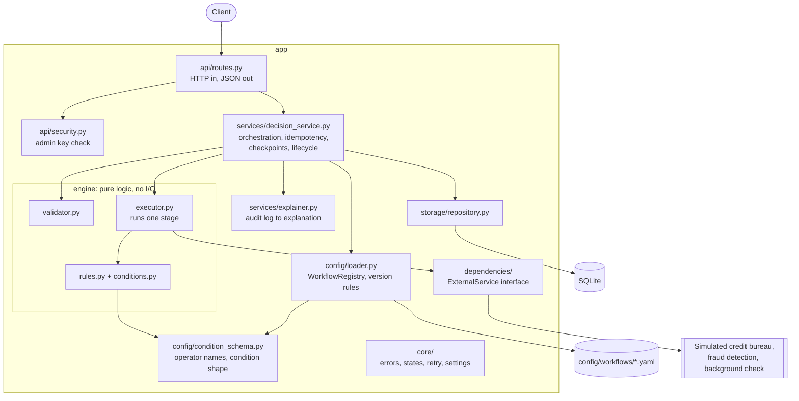
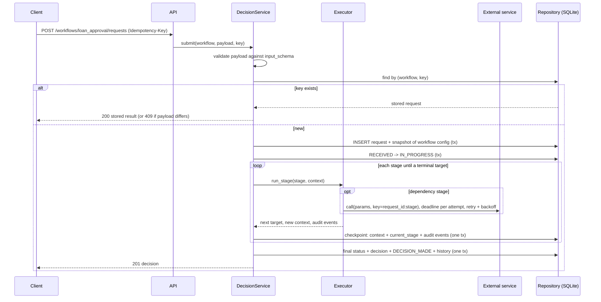
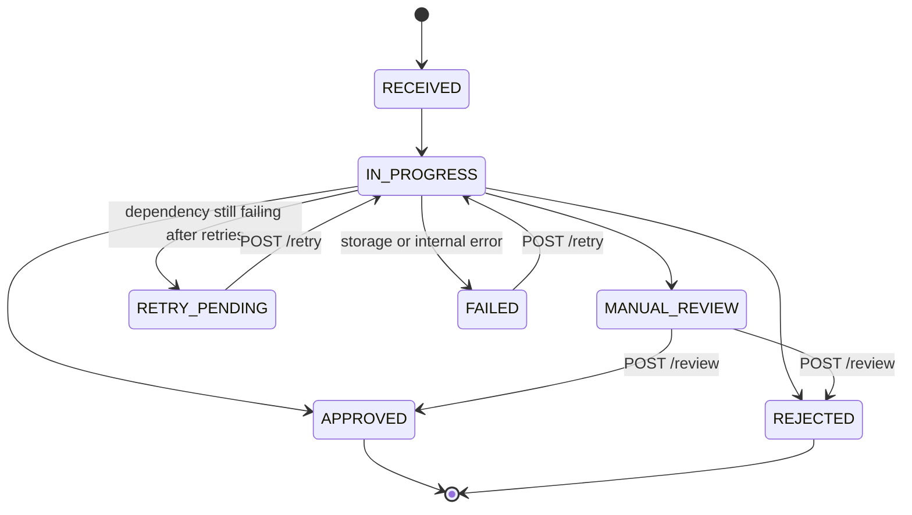

# Architecture

## 1. Problem understanding

Businesses run many approval-style processes that share the same skeleton:
a request arrives, it is checked against rules, some outside system is
consulted, and someone (or something) decides. The rules change often, the
outside systems fail sometimes, clients resend requests, and auditors later
ask "why was this rejected?".

So the platform has to be good at four things, and each one maps to a part
of the design:

| Need | Where it is handled |
|---|---|
| Express many workflows without new code | YAML config + generic engine (`app/config`, `app/engine`) |
| Survive failures without corrupting state | checkpoints, transactions, retries, idempotency (`app/services`, `app/storage`, `app/core/retry.py`) |
| Explain every decision | rule trace with data references in an append-only audit log (`app/services/explainer.py`) |
| Tolerate change | versioned config snapshots per request, safe hot reload, lenient input |

### Scope boundaries

In scope: intake and validation, rule evaluation, branching, external calls
with deadlines and retries, lifecycle state, audit, a manual review queue and
its resolution, config reload with version rules, admin protection.

Out of scope (on purpose, see section 9): full user authentication (admin
actions use an API key as a stand-in), a UI for editing rules, asynchronous
worker queues, multi-node deployment.

---

## 2. Component view

| Component | One job | Knows about |
|---|---|---|
| `api/routes.py` | translate HTTP to service calls | service, schemas |
| `api/security.py` | check `X-Admin-Key` on admin endpoints | settings |
| `services/decision_service.py` | drive a request through its lifecycle | engine, storage, registry |
| `services/explainer.py` | rebuild a readable story from the audit log | audit event format |
| `engine/validator.py` | check input against `input_schema` | config models |
| `engine/conditions.py` | evaluate each operator and record every check | operator list from config |
| `engine/rules.py` | evaluate a stage's rules, pick the verdict | conditions |
| `engine/executor.py` | run ONE stage, call services with a deadline, return next target and audit events | rules, dependency interface, retry |
| `config/condition_schema.py` | define which operators exist and what a valid condition looks like | nothing |
| `config/loader.py` | parse, validate, enforce version rules, hot-swap configs | config models |
| `storage/repository.py` | atomic writes of state + history + audit | SQLite |
| `dependencies/` | talk to external services behind one interface | errors |
| `core/` | shared vocabulary: errors, states, retry policy | nothing |

**Coupling rules.** Dependencies point one way:
`api -> services -> (engine | storage | config | dependencies) -> core`.
`tests/test_architecture.py` parses every module and fails if any import
breaks this direction, so the structure cannot erode quietly. The condition
language is split on purpose: the config layer owns *what is allowed*
(operator names, shapes), the engine owns *how it is evaluated*, and the
engine checks at import time that it implements every allowed operator.
The engine has no database code, so it is unit-testable and could run in a
worker process unchanged. The repository has no business logic, so it could
be swapped for PostgreSQL by rewriting one file. The executor only sees the
`ExternalService` interface, so a real HTTP client replaces a simulator
without touching the engine.

---

## 3. Data flow

### Submitting a request

### Request lifecycle

Allowed moves are declared once in `core/states.py`. Any other move raises
`InvalidStateTransition` (HTTP 409).

### Data model

| Table | Purpose | Notes |
|---|---|---|
| `requests` | current state of each request | `UNIQUE(workflow_name, idempotency_key)`, `version` for optimistic locking, `workflow_snapshot` holds the exact config used, `current_stage` is the resume point, index on `(status, created_at)` serves the review queue |
| `state_history` | every status change with stage and reason | append only |
| `audit_log` | every event: rule results, branch choices, each external call attempt, decisions, reviews, duplicates | append only, JSON details |

---

## 4. Robustness

### Idempotency and duplicates
* Client sends `Idempotency-Key`. Without one, the key is derived from a hash
  of the payload, so an identical resend is still recognised.
* Same key and same payload: stored result is returned with HTTP 200 and
  `Idempotent-Replayed: true`. The workflow does not run again and external
  services are not called again.
* Same key, different payload: HTTP 409. Silently picking one would hide a client bug.
* Two identical requests at the same moment: the database unique constraint
  lets exactly one insert win; the loser reads the winner's record.
  (`test_concurrent_duplicates_create_exactly_one_request` sends 8 in parallel.)
* External calls carry the key `request_id:stage_name`, identical across
  retries and resumes, so the remote side can deduplicate too.

### Retries
* `core/retry.py`: exponential backoff (`base_delay * 2^(n-1)`), capped by
  `max_delay`, with jitter so many clients do not retry in lockstep.
* Only transient errors (timeout, unavailable) are retried. Permanent errors
  (bad request, unknown entity) fail fast and go to `on_permanent_failure`
  (default `MANUAL_REVIEW`), since retrying them only adds load.
* Retries exhausted: the request moves to `RETRY_PENDING` and keeps
  `current_stage` on the failed stage. `POST /requests/{id}/retry` resumes
  from there. Earlier stages are not re-evaluated.

### Deadlines on external calls
* Every attempt has a deadline, `timeout_seconds` in the stage config
  (default 2 s). The executor runs the call on a small thread pool and stops
  waiting when the deadline passes.
* A missed deadline raises `DependencyTimeout`, which is transient, so the
  normal retry and backoff logic handles it with no special case.
* The pool has a fixed size (16). That works as a bulkhead: even if a service
  hangs on every call, it cannot use up all the threads the API needs.
* Demo: an applicant id containing `SLOW` makes the simulator answer after
  5 s; the 2 s deadline cuts it off on every attempt (`tests/test_timeouts.py`).

### Consistency and partial save failures
* Each stage is saved as a checkpoint in ONE transaction: context,
  `current_stage`, audit events and history rows. Either all of it is saved
  or none of it is.
* If that transaction fails, it rolls back, the request is marked `FAILED`
  at the last good checkpoint, and the client gets HTTP 503. A retry resumes
  from that checkpoint. Tested by injecting a real `sqlite3.OperationalError`
  just before `COMMIT` (`tests/test_partial_save.py`).
* Optimistic locking: every update says `WHERE version = :expected`. If two
  workers race on the same request, the second gets `ConcurrentModification`
  (409) instead of overwriting the first.
* Any unexpected exception during processing also marks the request `FAILED`,
  so a request is never left silently stuck.

### Stuck request recovery (lease timeout)
* Worst case: storage fails on the checkpoint AND again on marking the request
  `FAILED`, or the process crashes mid-run. The request is left `IN_PROGRESS`
  at its last good checkpoint.
* Every saved step updates `updated_at`, which acts as a lease. A request
  `IN_PROGRESS` with no saved progress for `DECISION_STALE_AFTER_SECONDS`
  (default 60) is treated as stuck.
* Three ways it gets picked up, all using the same code path:
  1. the client just calls `POST /requests/{id}/retry` (before the lease ends it gets 409 "still being processed")
  2. `POST /admin/recover` resumes every stuck request
  3. on startup the app recovers anything left over from a crash
* Safe with several workers: a request that is really being processed keeps
  bumping its `version`, so the optimistic lock makes recovery skip it.

### Config safety
* YAML is parsed into strict Pydantic models. Unknown keys (typos), unknown
  operators, dangling stage references, duplicate rule ids, unknown external
  services and cycles between stages are all rejected at load time.
* Reload is all or nothing. If any file is invalid, the running config stays
  in place and the endpoint returns 400 with the exact problem.
* A step limit (`DECISION_MAX_STEPS`) is a second guard against runaway workflows.

### Version rules
* The same workflow name and version must always mean the same content.
  Editing a rule without bumping `version` is refused with 400, and the
  running rules stay in place.
* Versions only go up. Rolling back means publishing the old rules under a
  new, higher number, so the audit trail never has two meanings for one number.
* Both rules are checked against the running config **and** against the
  versions stored with past requests, so they also hold across restarts.
  A file edited while the app was down stops startup with a clear message.
* The content fingerprint ignores default values, so adding a new optional
  setting to the platform does not invalidate existing workflow versions.

### Admin protection
* Endpoints that change config or record a human decision (`reload`,
  `review`, `recover`) require the `X-Admin-Key` header when
  `DECISION_ADMIN_API_KEY` is set. Wrong or missing key: 401.
* The key is compared in constant time, so it cannot be guessed from response timings.
* Without a key the app runs in open dev mode and logs a warning at startup;
  `/health` reports which mode is active.
* The check is one FastAPI dependency (`api/security.py`). Moving to OAuth or
  JWT behind a gateway changes only that function.

---

## 5. Explainability and audit

Every rule evaluation stores the rule id, description, pass or fail, action
taken, and for each leaf check the **field path, the actual value read from
the request data, the operator and the expected value**. Combined conditions
(`all`, `any`, `not`) record every leaf they looked at.

External calls store every attempt, the error of each failed one, the final
response and the context key it was stored under. Decisions store the
deciding reason in plain text. Reviews store the reviewer and comment.

`GET /requests/{id}/explanation` rebuilds a readable story from the audit
log on demand. It is never stored separately, so it can never drift from what
actually happened. Each request also records the workflow version and a
content fingerprint of the config it ran under.

See [DECISION_EXAMPLES.md](DECISION_EXAMPLES.md) for real output.

---

## 6. Configurability and requirement changes

| Change | What you do | Code change? |
|---|---|---|
| New threshold | edit a `value` in YAML, bump `version`, `POST /workflows/reload` (refused if you forget the bump) | no |
| Rule becomes softer (reject to review) | change `on_fail` | no |
| New rule or new stage | add it to YAML | no |
| New branch condition | add to `branches` | no |
| New workflow (e.g. vendor approval) | drop a new YAML file, reload | no (covered by a test) |
| New input field from clients | send it; extra fields are accepted, use it in rules when ready | no |
| New external service | write one `ExternalService` class, register it in `container.py` | small, isolated |
| New operator | add its name to `config/condition_schema.py` and one line to `OPERATORS` in `engine/conditions.py` | small, isolated |

**Version pinning.** A request stores a snapshot of the workflow config it
started with. If rules change while a request is paused in `RETRY_PENDING`,
it resumes under its original rules. New requests get the new rules. This
keeps decisions reproducible and fair to the applicant.

---

## 7. Trade-offs

| Decision | Alternative | Why this choice | Cost |
|---|---|---|---|
| YAML with a small condition language | embedded scripting (Python eval, JS) or a full rules engine (Drools) | safe (no code execution), validatable at load time, readable by business users | less expressive; very complex logic needs a new operator |
| Evaluate all rules in a stage, not stop at first failure | short-circuit | reviewers see every problem at once; costs microseconds | slightly more audit data |
| Synchronous processing inside the HTTP request | queue + workers | simple to run and test; most stages are fast | slow external calls and backoff sleeps hold a request thread; see scaling |
| SQLite | PostgreSQL | zero setup for a hackathon; real transactions and unique constraints | single writer; swap the repository for production |
| Checkpoint after every stage | save only at the end | precise resume, no repeated external calls for finished stages | one extra write per stage |
| Snapshot config per request | always use latest config | reproducible decisions, safe mid-flight changes | a few KB per request |
| Derive idempotency key from payload when missing | require the header | protects clients that forget the header | two genuinely separate but identical requests are merged; clients who need that send distinct keys |
| Accept unknown input fields | reject them | clients can roll out new fields before config uses them | typos in optional field names are not caught |
| Explanation rebuilt from audit log | store a separate explanation | one source of truth | small compute on each read |
| Optimistic locking | row locks / `SELECT FOR UPDATE` | no lock held across slow external calls | loser of a race gets 409 and must retry |
| Deadline via a thread pool | async HTTP client with native timeouts | works with any adapter, sync or not; pool size doubles as a bulkhead | an overrunning call keeps its thread until it returns |
| Refuse config edits without a version bump | auto-increment the version on reload | the person changing rules decides what counts as a new version; the audit trail stays honest | one more thing to remember (the 400 message says exactly what to do) |
| Shared API key for admin actions | OAuth / JWT with roles | no identity provider needed for a demo; one function to replace later | one key for all admins; the reviewer name is self-declared |
| Oldest-first review queue | priority queue (by amount, SLA) | fair and predictable, uses a plain index | big or urgent cases are not jumped ahead |

---

## 8. Assumptions

* Input arrives as JSON objects; dates and currencies are plain numbers or strings.
* A workflow is a directed acyclic graph of stages. Loops are not needed for the example use cases and are rejected.
* External services accept an idempotency key (most payment, KYC and bureau APIs do).
* "Manual review" ends with a human choosing APPROVED or REJECTED through the API.
* Invalid input is rejected with 422 and not stored. The client owns fixing and resending it.
* Full user authentication is handled by a gateway in front of this service; the admin API key is a stand-in for it.
* Monetary values use the same currency within one request.

---

## 9. Scaling considerations

What changes when traffic grows, in the order it would be needed:

1. **Database.** Move from SQLite to PostgreSQL. Only `storage/` changes. The
   unique constraint, transactions and version column carry over directly.
   Partition `audit_log` by month; it is the fastest growing table.
2. **Async processing.** Return `202 Accepted` after intake and put the
   request id on a queue (SQS, RabbitMQ, Kafka). Stateless workers run the
   existing stage loop. Checkpoints already make this safe: any worker can pick
   up any request from its `current_stage`, and optimistic locking prevents two
   workers from processing the same one.
3. **Scheduled retries.** Replace manual `POST /retry` with a scheduler that
   re-queues `RETRY_PENDING` requests using a backoff timestamp, and call
   `POST /admin/recover` (already built) on a timer instead of only at startup.
4. **Circuit breaker per dependency.** When a service is clearly down, stop
   calling it for a cool-off period and send requests straight to
   `RETRY_PENDING`, protecting both sides.
5. **Horizontal API scaling.** The API is stateless apart from the in-memory
   registry, so run N replicas behind a load balancer. Config reload becomes
   a broadcast (or each replica polls a config store with the fingerprint).
6. **Config store.** Move YAML into a versioned table or Git-backed service
   with review and approval before activation.
7. **Observability.** Export metrics per workflow and stage (latency, decision
   mix, retry counts, dependency error rates) and ship the audit stream to a
   warehouse for analytics.

Rough capacity note: rule evaluation is in-memory and takes well under a
millisecond per stage, so throughput is bound by external calls and database
writes, both of which scale with the steps above.

---

## 10. Known limitations

* A stuck request waits for the lease time (default 60 s) before it can be
  recovered. That delay is on purpose: recovering sooner could run the same
  request twice if its original worker is only slow, not dead.
* Retry backoff sleeps happen inside the HTTP request thread (scaling step 2 removes this).
* Python cannot kill a running thread. A call cut off by its deadline keeps
  its pool thread until the service finally answers, and that answer is
  thrown away. Real HTTP adapters should also set their own socket timeout.
* The admin key identifies "an admin", not a person, so the reviewer name in
  a review is taken from the request body. Real auth would take it from the token.
* The simulators keep their idempotency cache in memory, so it resets on restart.
